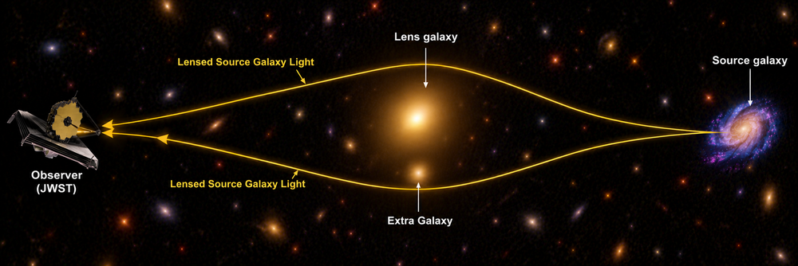
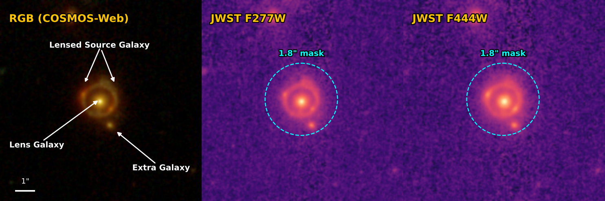

# PyAutoLens Assistant


When two or more galaxies are aligned perfectly down our line-of-sight, the
background galaxy appears multiple times. This is strong gravitational lensing,
and **PyAutoLens** makes it simple to model strong gravitational lenses.

This repository is the **PyAutoLens Assistant**: an AI assistant which **lets you use natural language** to do gravitational lensing science. 

Still want to see the Python code? Try the [Google Colab notebook](https://colab.research.google.com/github/PyAutoLabs/autolens_assistant/blob/main/docs/colab/cosmos_web_ring_colab.ipynb),
which walks through the same COSMOS-Web Ring analysis with Colab's Gemini AI on hand to answer your questions.

## Getting Started

The assistant runs inside an **AI coding agent**, a tool that can read this repository, run Python on your computer
and look at the results. Pick your agent: [Claude Code](docs/setup/claude_code.md) or [Codex](docs/setup/codex_cli.md)
are recommended, and [GitHub Copilot CLI](https://github.com/PyAutoLabs/PyAutoScientist/blob/main/AI_OPTIONS.md#github-copilot-cli)
or [OpenCode](https://github.com/PyAutoLabs/PyAutoScientist/blob/main/AI_OPTIONS.md#opencode) are free AI options
if you want to try it without paying.

Once it is installed, open your AI coding agent and paste in the starting prompt below. The agent downloads this
repository and installs **PyAutoLens** for you, so there is nothing else to set up.

### Using PyAutoLens Assistant

A strong lens forms when a foreground galaxy's mass bends the light of a galaxy far behind it, so that we see the
background galaxy stretched into arcs, multiple images or a full ring:



To illustrate the `autolens_assistant` we will use James Webb Space Telescope imaging data of the 
[**COSMOS-Web Ring**](https://ui.adsabs.harvard.edu/abs/2024A&A...687A..61M/abstract), whose imaging
ships with this repository in `dataset/imaging/cosmos_web_ring`:



Take note of the **lens galaxy, lensed source galaxy, extra galaxy** and the **1.8" circular mask**, your first 
interactions with the `autolens_assistant` may ask you about how to handle these in your analysis!

### Starting prompt

If you've not used the PyAutoLens AI Assistant before, use the prompt below. It'll ask your background (e.g.
scientist, PhD student, member of the general public) and explain gravitational lensing to you accordingly.

<sub><b>Starting prompt for Claude Code, Codex or other AI coding agent</b></sub>

```text
I want to use the PyAutoLens Assistant: https://github.com/PyAutoLabs/autolens_assistant
First clone that repository, cd into it and follow its AGENTS.md.

I'd like to understand how gravitational lensing works using the JWST image of the COSMOS-Web Ring that ships with the assistant. Show me the picture, explain what we are looking at, and walk me through fitting a lens model so we can measure the mass inside the ring and see how well the model reproduces the observations. Pitch it at my level: ask me what my background is first. Explain what we are doing as we go, and let me ask questions or change the analysis along the way.
```

From here you should be able to have a conversation with the assistant. If you're new to gravitational lensing you
can begin learning about the physics, and if you're already an expert you can run some detailed lens modeling on the
COSMOS-Web Ring!

## Customize Your Assistant

The `autolens_assistant` adapts its behaviour to suit your prompt:

- Want the assistant to ask questions before performing a task, helping you understand the analysis and make informed choices? Ask it to guide you through the process.

- Want to talk through the different ways you could model your lens before deciding on one? Simply say so in your initial prompt.

- Want it to complete a task end-to-end without consulting you? Tell it to **one-shot** the task.

### Teacher Mode

If you are new to gravitational lensing, particularly an undergraduate or early-stage PhD student, ask the assistant 
to use **Teacher Mode**. It will explain the fundamentals of lensing and lens analysis in greater detail, while providing direct links to relevant, human-readable documentation so that you can understand what **PyAutoLens** is doing.

<sub><b>Example Natural Language Prompt for Claude Code, Codex or other AI coding agent</b></sub>

```text
Teacher mode.

I'm new to PyAutoLens and want to learn the basic workflow end-to-end. Can you
walk me through a simple example where we: 1) simulate Euclid-like imaging of
a simple strong lens; 2) make some plots of the lens and investigate its properties and;
3) fit the data and recover the lens model.
```

### More ambitious examples

These longer prompts show how far the assistant can be pushed:

- [Detect a dark matter subhalo in SLACS0946+1006](docs/advanced_examples.md#detect-a-dark-matter-subhalo-in-slacs09461006), reproducing a published detection of a dark matter subhalo with Bayesian model comparison.
- [Combine different data types and lensing scales](docs/advanced_examples.md#combine-different-data-types-and-lensing-scales), jointly fitting imaging, interferometer data and a weak-lensing catalogue of a group-scale lens.

## Scientific Context

The assistant knows more than the PyAutoLens API. It ships with a **literature wiki** (`wiki/literature/`) built from
over 300 strong lensing papers, organised by topic (for example the mass-sheet degeneracy, dark matter substructure
and time-delay cosmography) and by survey or system (for example SLACS, TDCOSMO and Euclid). So if your prompt
mentions, say, ALMA observations of submillimetre galaxies, the assistant answers with the relevant literature in mind.

Before you start a serious analysis, add the papers that matter for your own work. Just point the assistant at them
and it will read and file them for you:

<sub><b>Example Natural Language Prompt for Claude Code, Codex or other AI coding agent</b></sub>

```text
Ingest the following paper into the literature wiki so you can use it
when we talk about subhalo detection:

  arXiv:2401.01234

(Or, if you have the PDF locally: /path/to/subhalo_paper.pdf)

Once it's ingested, summarise the paper and how it complements similar
works in the literature wiki
```

The more relevant papers you add, the better the assistant gets at framing decisions, citing prior work and spotting
caveats in your results.

## Science Project

When you start a real scientific study, ask the assistant to set up a **science project**. This is a tidy folder, backed by its
own GitHub repository, that holds everything for that study: the data, the analysis scripts, the results, the plots
and a record of your conversations with the assistant.

- **Readable.** Every script the assistant writes is documented and can be turned into a Jupyter notebook.
- **Shareable.** Collaborators can open the GitHub repository to see where the project stands and how each result was
  made, and suggest changes or build on it.
- **Scales up.** The project can send jobs to an HPC cluster (CPU or GPU), keep its files in sync and track the runs.
- **Reproducible.** If the work becomes a paper, the repository is its open-source companion, so readers can rerun
  the analysis or start their own from it.

To start one, just ask:

<sub><b>Example Natural Language Prompt for Claude Code, Codex or other AI coding agent</b></sub>

```text
Start a science project for my SDSSJ0946+1006 analysis.
```

## How does PyAutoLens-Assistant actually work?

The `autolens-assistant` starts with the general knowledge and reasoning capabilities of 
the underlying foundation model your coding agent runs (e.g. an OpenAI model in Codex, a Claude model in Claude Code). 
The `autolens-assistant` supplements this with the scientific wiki above and two more sets of AI-readable markdown. 
The folder `wiki/core` provides it with a quick look-up mechanism of the PyAutoLens API documentation. The folder
`skills` pairs it with the end-to-end analysis scripts found in the [`autolens_workspace`](https://github.com/PyAutoLabs/autolens_workspace). When the `autolens-assistant` 
receives your prompt, it scans these folders to give you the best possible answer
you need. The JOSS paper located in the `paper` folder provides a more detailed description.

## Conversational Assistants

You can also talk to the assistant in an ordinary chat, by connecting this repository to ChatGPT or Claude through
their GitHub connector. This works well for asking questions, planning an analysis, learning and discussing papers,
but needs a paid subscription. A chat cannot run code or look at your data, so for lens modeling itself use a coding
agent. The [PyAutoLabs AI options page](https://github.com/PyAutoLabs/PyAutoScientist/blob/main/AI_OPTIONS.md#chat-instead-of-an-agent)
shows how to set it up.

## Natural-language development ecosystem

In March 2026, following more than a decade of exclusively human-led software development, `PyAutoLens` transitioned
to a fully natural-language, agentic-AI development ecosystem called
[`PyAutoScientist`](https://github.com/PyAutoLabs/PyAutoScientist). The ecosystem is organised as a software organism
whose core repositories mirror the roles of human organs:
[`PyAutoBrain`](https://github.com/PyAutoLabs/PyAutoBrain) acts as the reasoning centre, classifying, planning, and
routing tasks through specialist coding agents; [`PyAutoMind`](https://github.com/PyAutoLabs/PyAutoMind) captures
intent by recording plain-English development requirements and tracking them from initial ideas to completed
implementations; and [`PyAutoMemory`](https://github.com/PyAutoLabs/PyAutoMemory) provides long-term scientific memory
through cross-linked literature wikis and verifiable citations. Humans remain firmly in the loop, defining the
scientific objectives, supervising the development process, and approving consequential decisions.

## Benchmarks

How well does the assistant work with a given AI agent and model? To answer that fairly, the example prompts in this
README are also saved as fixed **benchmark prompts** in [`benchmarks/`](benchmarks/), each with a scoring rubric
(the COSMOS-Web Ring fit is the `cosmos-web-ring-fit` card). A small harness records each run's conversation, results
and score, so different agents and models, or the same model on different days, can be compared on evidence.

**No run has been scored yet**, so nothing here is a measured performance claim for any agent or model. The protocol
is in [`benchmarks/README.md`](benchmarks/README.md).

## License

This repository is released under the [MIT License](LICENSE), consistent with the wider
PyAuto\* ecosystem. The assistant ships agent instructions and reference material derived
from the public PyAuto\* repositories; the underlying libraries are released under their
own licenses (see each repo).

<details>
<summary><sub>Note for AI coding agents</sub></summary>

If a prompt sent you here and you are not already inside this repository, clone it
(`git clone https://github.com/PyAutoLabs/autolens_assistant.git && cd autolens_assistant`), then read `AGENTS.md`
in full and follow it. Hooks and project settings do not load for a folder cloned mid-session, so run the code gate
yourself (`python autoassistant/audit_skill_apis.py --code "<snippet>"`) before running PyAutoLens code, and tell the
user in one line that relaunching the agent inside `autolens_assistant/` gives the full setup.

</details>

<sub><i><a href="https://open.spotify.com/track/6LeTQu4NvTnLRRiB8GVFQe">if you don't know, don't worry</a></i></sub>
